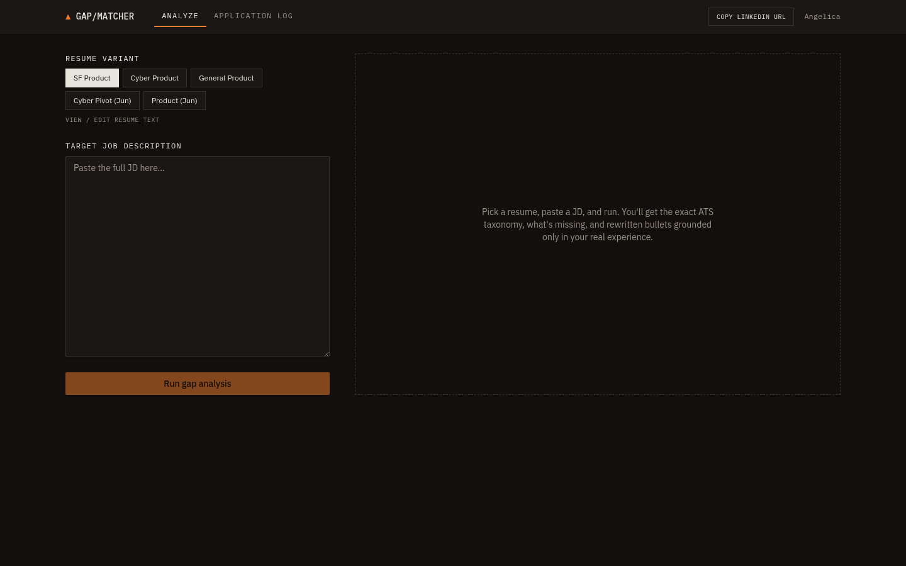
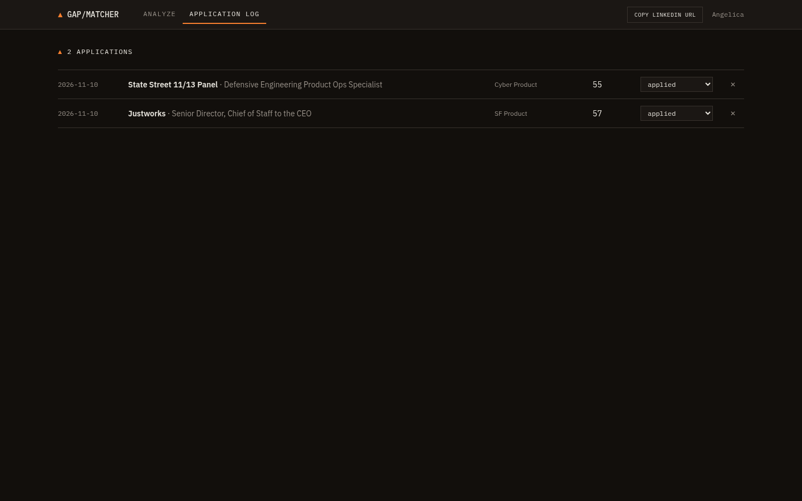

# Gap/Matcher — Reverse-ATS & Semantic Gap Analyzer

> An AI-powered job search workspace that compares a resume against a job description the way an enterprise applicant tracking system (Workday, Greenhouse, Lever) would, then tailors resume bullets and application materials **based only on real experience, with nothing made up**.

**Live app:** [ab-internal-job-analysis.lovable.app](https://ab-internal-job-analysis.lovable.app)

Built by **Angelica Bonus** · [LinkedIn](https://www.linkedin.com/in/abonus)

---

## The problem

Generic AI tools rewrite resumes into filler buzzwords or invent experience, and they often miss the exact terms an ATS scores for (e.g. *gRPC vs REST*, *NIST 800-53 vs SOC 2*). Gap/Matcher treats tailoring as a precision task: find the real gaps, reword only what's true, and flag anything that shouldn't be claimed.

## Features

| | Feature | What it does |
|---|---|---|
| 01 | **Resume variants** | Switch between role-specific resumes (Cyber Product, SF Product, General Product) and edit the text before each run. |
| 02 | **Gap analysis** | Scores the match and sorts keywords, hard skills and leadership skills into present, partial or missing. |
| 03 | **Bullet tailoring** | Rewrites existing bullets to use the job description's wording. Original metrics stay as they are, and no new employers, tools or certifications are added. |
| 04 | **"Do not claim" list** | Lists gaps the resume can't back up, so they never end up in an application. |
| 05 | **Tailored summary** | Writes a summary aimed at the specific role. |
| 06 | **Cover letter generator** | Writes an editable, company-specific letter based on the tailored summary and real achievements. |
| 07 | **Application questions** | Answers portal questions (e.g. "Why this company? 150 words") using the resume, the job description and personal career notes, within the stated word limit. |
| — | **Application log** | Stores the exact job description, tailored bullets, cover letter, notes, status and date applied, for interview prep. |
| — | **Quality-of-life** | One-click LinkedIn URL copy and a dark theme for daily use. |

## Screenshots

**Analyze: resume and job description gap analysis**


**Application log**


## Tech stack

- **Frontend:** React 19, TanStack Start / Router, TypeScript, Tailwind CSS v4, shadcn/ui
- **Backend:** TanStack server functions on an edge runtime (Cloudflare Workers)
- **Database:** PostgreSQL (Lovable Cloud), Drizzle migrations
- **AI:** Lovable AI Gateway (LLM calls with structured output and strict grounding prompts)
- **Tooling:** Vite 7, Vitest, ESLint, Prettier
- **Built with:** [Lovable](https://lovable.dev)

## How the "no hallucination" rule works

1. The model gets only the selected resume text and the job description.
2. Rewrites can only rephrase existing bullets. Numbers and employers must match the source.
3. Anything the job description asks for that the resume can't support goes on the **Do not claim** list instead of into the copy.

## Run locally

```sh
git clone <this-repository-url>
cd <repository-name>
npm install
npm run dev
```

---

*Personal project, built to make my own job search faster and more precise.*
